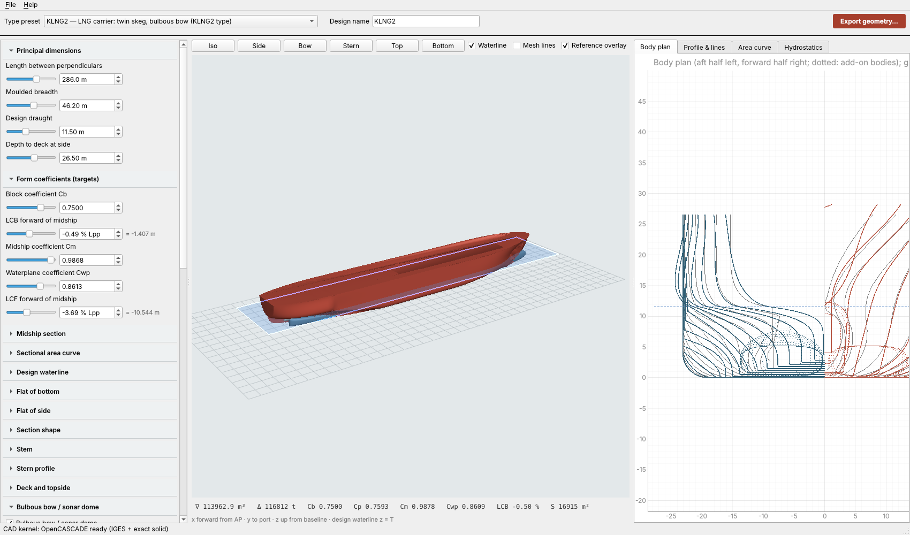

# Parametric Hull Form Designer 0.1

In-house parametric design tool for commercial-vessel hull forms (geometry only), written from
scratch. It generates fine and full hulls, with or without a bulbous bow or sonar dome, with a
single skeg, twin skegs or open shafts, and transom or closed sterns. The result is one closed
solid exported as **IGES** and/or **STL**.

Six presets reproduce the six supplied benchmark hulls (KCS, DTC, KVLCC2, JBC, KLNG2, DTMB 5415).



## Start

```bash
pip install -r requirements.txt        # numpy scipy PySide6 pyqtgraph PyOpenGL cadquery-ocp (+ matplotlib)
python main.py                         # GUI
python -m hullform presets             # list presets
python -m hullform build --preset KLNG2 --out out/ --iges --stl          # export
python -m hullform build --preset KCS --set bulb.on=false --set main.Lpp=200 --out out/
python -m hullform hydro --preset JBC  # hydrostatics only
python -m pytest -q tests              # tests
```

`run_designer.bat` (Windows) and `run_designer.sh` create a virtual environment on first start.
On Linux, Qt needs `libegl1 libxcb-cursor0`. Without `cadquery-ocp` the program still runs: preview,
hydrostatics and STL from the preview mesh (bodies not united, no IGES).

## What you control

About 90 parameters in 16 groups (full list: `docs/Parameters.md`):

| Group | Main parameters |
|---|---|
| Principal dimensions | Lpp, B, T, D |
| Form coefficients (targets, met exactly) | **Cb** and **LCB** of the complete hull, Cm, Cwp, LCF |
| Midship | rise of floor (bilge radius follows from Cm) |
| Sectional area curve | parallel body extent, run/entrance end shape, immersed transom area |
| Design waterline | parallel extent, entrance/run shape, transom half-breadth |
| Flat of bottom / flat of side | extents and tapers |
| Section shape | keel exponent aft/forward (hollow-skeg / V / U), waterline flare aft/forward |
| Stem / stern profile | stem rake, forefoot radius; transom x and height (immersed or dry), counter knuckle, skeg heel, radii |
| Deck and topside | deck half-breadth amidships and at the transom, deck line shape, sheer fwd/aft, flare |
| Bulbous bow / sonar dome | on/off, protrusion (Kracht L_PR), top/bottom/nose height, breadth, Δ-O-∇ shape, nose fullness; bottom below the keel makes a sonar dome |
| Stern tube boss | shaft height, radius, aft end, length |
| Skegs | single / **twin** / open; twin: shaft offset, width, length, bottom, aft rake, fairing |
| CAD | junction fillet radius (bulb/skegs) |

Shape parameters are dimensionless (× Lpp, × B/2, × T, × D), so changing L, B, T or D keeps the
form. The GUI shows the value in metres next to each one.

## How the hull is built (short)

Longitudinal design curves (area curve, waterline, flat of bottom/side, profile, deck) are solved so
the main hull meets Cb, LCB, Cm, Cwp and LCF. Every transverse section is solved to have exactly the
area-curve value. The main hull is united with the parametric bulb/dome, boss and skeg bodies, and
the Cb/LCB targets are then corrected so that the **complete** hull meets them. Details:
`docs/Design.md`.

## Export

*Export geometry…* (GUI) or `python -m hullform build`:
* **IGES**: trimmed B-spline surfaces (or B-rep), m or mm.
* **STL**: binary, watertight, 5 resolution levels (chordal deviation 2·10⁻³ … 1.25·10⁻⁴ Lpp).
* Every file is read back and checked: IGES faces sewn → free edges; STL → open / non-manifold
  edges. The exact displaced volume, LCB and wetted surface of the solid are logged.

## Presets fitted to the supplied hulls

PRESET_TABLE

Body-plan RMS = RMS of the half-breadth difference below 1.05 T over the whole length, in % of B/2
(propellers/rudders in the reference files masked). Comparison plots: `docs/compare_*.png`.
**KLNG2: the design draught (11.5 m) and Lpp (AP at the file origin) were assumed. Please
confirm them.**

## Limits (version 0.1)

The presets are parametric approximations, not the original benchmark lines. Not yet supported:
inverted/axe bows, raked transoms, chines/knuckles, propeller apertures, ducts and other ESDs,
bilge keels. The GUI does not yet import arbitrary IGES/STL hulls for fitting (the core functions
exist: `hullform.reference`, `hullform.fit`). See `docs/Design.md` §9.
